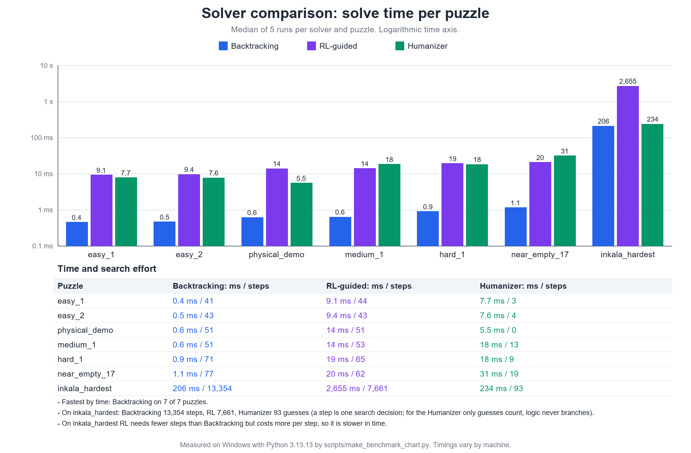
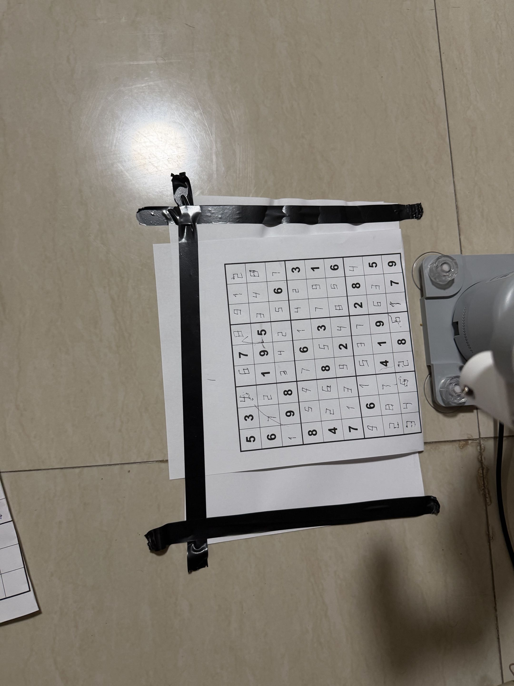
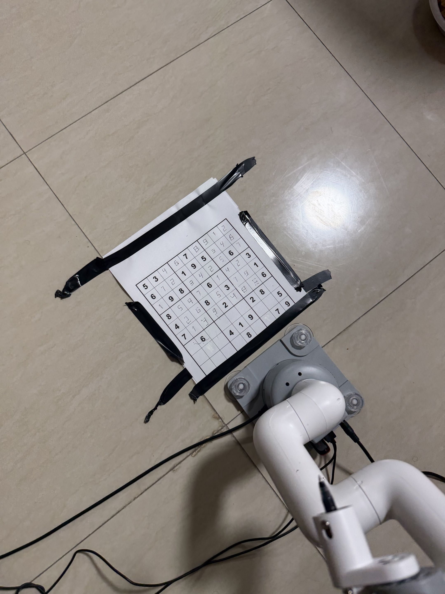

# sudoku_robot

A Sudoku-solving robot built on a **mycobot 280 Pi** arm with a pen in its
end effector and an **iPhone** acting as an RTSP camera. It:

1. **Sees:** grabs one frame from the iPhone, finds the printed grid, flattens
   the perspective, and reads the 81 cells by template matching.
2. **Solves:** with one of three strategies: classic backtracking,
   RL-guided backtracking, or the **Humanizer**, which uses human solving
   techniques and explains every step.
3. **Writes:** moves the pen to every empty cell on the paper and either
   presses a dot (`mark` mode, the default) or draws the digit in
   seven-segment style (`digit` mode).

Every stage can also be run on its own. The solvers, the writer (with the
simulated arm), the renderer and the tests need no hardware.

> **Status: verified on the real robot.** The full pipeline has been run end
> to end on the real **mycobot 280** arm: the puzzle was **read from the
> iPhone camera** (`--from-camera`), solved, and the **complete solution was
> written onto the paper** in `digit` mode (seven-segment digits). The run was
> filmed. All three solvers (`backtracking`, `rl`, `humanizer`) were tried,
> and the corner check passed.
> See [Hardware verification](#hardware-verification) for what this does and
> does not cover, and [Known limitations](#known-limitations) for what is
> still true.

---

## Quick start (any machine, no hardware)

```bash
git clone <this repo> sudoku_robot && cd sudoku_robot
# Windows:  powershell -ExecutionPolicy Bypass -File scripts\setup.ps1
# Linux/Pi: bash scripts/setup.sh
python -m sudoku_robot --solver humanizer --puzzle physical_demo --write --explain   # solve + simulated write
```

---

## Project structure

```
sudoku_robot/            the Python package (all the real code)
    cli.py                 entry point: python -m sudoku_robot
    config.py  fonts.py    every file path, serial setting and reach limit; font lookup
    solver/                backtracking, rl/, humanizer, plus the SudokuSolver interface
    vision/                iPhone capture, grid detection, digit recognition
    writer/                arm controllers, grid layouts, corner check, digit strokes, write pipeline
    puzzles/  benchmark/   sample puzzles, generator, printable-PNG renderer; solver comparison
config/                  per-robot settings YOU edit or re-teach (see "Robot-specific files")
    corners.json             3 grid-corner poses: planned by place_paper.py or taught (per setup)
    arm_calibration.json     pen-down/up heights + tool orientation (re-measure per setup)
    camera_config.json       your iPhone's RTSP URL (gitignored; copy the example)
    camera_config.example.json
    README.md                what each of these files is
scripts/                 things you run directly (they work from any folder)
    setup.sh  setup.ps1      create venv + install pinned requirements + verify (Pi/Linux, Windows)
    verify_env.py            environment check: OK / WARN / FAIL
    place_paper.py           plan a fully reachable grid; the arm shows where the paper goes
    jog_console.py           jog the arm by hand-typed moves; can teach config/corners.json
    teach_cli.py             optional hand-teaching of digit shapes
    export_digits.py         regenerate the digit database (teach_data/digits.json + picture)
    make_benchmark_chart.py  measure all three solvers and redraw docs/benchmark_times.png
docs/                    photos of the real run on the mycobot 280
calib/                   generated images -- output, never edited by hand
                         (camera test frames, grid-detection overlays, calibration photos)
tests/                   pytest suite: python -m pytest
printable_puzzles/       print-ready PNGs of the sample puzzles (20 mm cells)
teach_data/              digits.json = the digit database (how each of 1-9 is written)

README.md  LICENSE  requirements.txt  pytest.ini  .gitignore  .gitattributes
```

Rule of thumb:
- **Edit** things in `config/`.
- **Run** things in `scripts/` (or `python -m sudoku_robot...`).
- Everything in `calib/` is **output**.
- `__pycache__/` and `.pytest_cache/` are created by Python and pytest
  whenever you run code or tests. They're gitignored; delete them any time.

---

## Setup: from a clean clone to a working install

`requirements.txt` pins **exact** versions of every package, including
indirect dependencies. They're the versions running on the robot's Pi, so
every install gets the same environment. The target interpreter is
**Python 3.13**. Both setup scripts:

1. create a venv;
2. install the pins;
3. run `scripts/verify_env.py`, which reports `OK` / `WARN` / `FAIL` for:
   - the Python version;
   - every package's installed version against its pin, and whether it
     imports (`cv2`, `pymycobot`, `serial`, `PIL`, `numpy`, `pytest`);
   - the pymycobot methods this project calls;
   - the DejaVu font;
   - `config/arm_calibration.json` / `config/corners.json` / `config/camera_config.json`
     (and warns about old copies left in the project root);
   - on the Pi, the serial port.

   It exits non-zero on any `FAIL`, so a broken install is never silent.

Re-run the check any time with `python scripts/verify_env.py` (add `--hardware` on
the Pi).

### Windows: development and simulation only

You can run the solvers, simulated writes, rendering, corner
validation, the tests, and vision against saved `.jpg` frames. You can't
drive the arm unless it's connected over USB (see below).

1. Install **Python 3.13** from python.org (tick "Add python.exe to PATH").
2. In PowerShell, from the project folder:
   ```powershell
   powershell -ExecutionPolicy Bypass -File scripts\setup.ps1  # add -Fresh to rebuild the venv
   .venv-win\Scripts\Activate.ps1
   python -m pytest
   ```
   This uses **`.venv-win`**. A `.venv/` folder in the project (gitignored,
   so it isn't uploaded) is the Pi's Linux venv and won't run on Windows.
3. **Expected warning:** DejaVu Sans isn't shipped with Windows. Rendering and
   recognition fall back to Arial Bold and still work. To match the Pi exactly,
   copy `DejaVuSans-Bold.ttf` and `DejaVuSans.ttf` (from the Pi's
   `/usr/share/fonts/truetype/dejavu/`, or from dejavu-fonts.github.io) into
   `sudoku_robot/assets/fonts/`.
4. **Optional, to drive an arm over USB from Windows:** set
   `SUDOKU_ROBOT_SERIAL_PORT=COM3` (whatever Device Manager shows).

Manual equivalent of `scripts/setup.ps1` (run from the project root):
`py -3.13 -m venv .venv-win`, then
`.venv-win\Scripts\python -m pip install -r requirements.txt`, then
`.venv-win\Scripts\python scripts\verify_env.py`.

### Raspberry Pi: real hardware (mycobot 280 Pi)

1. System packages (Raspberry Pi OS / Debian):
   ```bash
   sudo apt install python3 python3-venv fonts-dejavu-core
   ```
2. From the project folder:
   ```bash
   bash scripts/setup.sh --hardware    # add --fresh to delete and rebuild .venv
   source .venv/bin/activate
   python -m pytest
   ```
   `--hardware` also requires `/dev/serial0` (the arm's UART) and the DejaVu
   font. The scripts work from any folder; the venv is always created in the project root.
3. Camera, only needed for `--from-camera`:
   ```bash
   cp config/camera_config.example.json config/camera_config.json
   ```
   Then put the `rtsp://...` URL your iPhone RTSP app displays in the file.
   The phone must be on the same WiFi network with the app in the foreground.
   Check the connection with `python -m sudoku_robot.vision.capture_check`.
4. **Re-teach the robot-specific files** (next section) before any real-arm write.

Manual equivalent of `scripts/setup.sh` (run from the project root):
`python3.13 -m venv .venv`, then
`.venv/bin/pip install -r requirements.txt`, then
`.venv/bin/python scripts/verify_env.py --hardware`.

---

## Robot-specific files: set these up on your robot

Two files in this repo describe **one particular physical setup**: this arm,
this pen mount, this table, and where the paper lies. **They are not
portable.** If you clone the project to run it on real hardware, or the paper
or pen moves, set them up again with the steps below. Everything else in the
repo is setup-independent.

| File | What it holds | How it's used |
|---|---|---|
| `config/corners.json` | Exactly **three** arm positions, `TL`, `TR` and `BL`: the **centres** of cell (0,0), cell (0,8) and cell (8,0), as `[x, y, z, rx, ry, rz]` (only x and y are used). They are either **planned** by `scripts/place_paper.py`, as now, or **taught** by jogging the pen onto a sheet with `scripts/jog_console.py`. | `TaughtCornersGridLayout` builds all 81 cell centres from these 3 points by an affine map, with the cell pitch forced to exactly 20 mm. The 4th corner isn't needed, because a flat sheet has no perspective. The file is read from disk at startup. **Nothing asks for corners at runtime.** Every real-arm write is checked against it first. |
| `config/arm_calibration.json` | `pen_down_z` (the Z at which the pen presses the paper), `pen_up_z` (travel height) and `orientation` (tool angle rx, ry, rz). | This is the single source of truth for every real-arm move. It's used by the main CLI, `scripts/place_paper.py`, `scripts/teach_cli.py replay`, and the teaching tool's touch checks. |

The coordinates are the arm's own base frame in mm. Viewed from behind the
base: **-Y is forward** (toward the paper's top edge), **+X is left**,
**-X is right**, and **+Z is up**. See `sudoku_robot/config.py`.

### Setting up on the robot (about 10 minutes, on the Pi)

You need: the arm powered and connected, the pen mounted, a ruler, and tape.

1. **Print the grid at true scale.**
   - Run `python -m sudoku_robot.puzzles.render --puzzle physical_demo`, then
     print `printable_puzzles/physical_demo.png` at **100% / "Actual size"**,
     never "Fit to page".
   - Measure one cell. It **must be 20 mm**.
2. **Check the pen-down height (`config/arm_calibration.json`).**
   - Run `python scripts/jog_console.py` and jog the pen down (`d 1`, then
     `d 0.5`) onto the table surface where the paper will go, until it just
     makes a mark.
   - Read `pos`: its z is your `pen_down_z`. If it differs from the file,
     edit the file. Keep `pen_up_z` about 30 mm higher, and set `orientation`
     to the last three numbers of `pos`.
   - Alternative: `python scripts/teach_cli.py release-servos`, hold the pen
     on the paper, run `python scripts/teach_cli.py capture-surface`, then
     `python scripts/teach_cli.py lock-servos`.
3. **Place the paper where the arm points (recommended):**
   ```bash
   python scripts/place_paper.py
   ```
   - This plans a square 9 × 9 grid of 20 mm cells, centred 170 mm in front
     of the base: top row 250 mm out, bottom row 90 mm out. Every cell is
     within reach.
   - It writes that plan to `config/corners.json`, backing up the old file
     first.
   - It then moves the pen to **3 mm above** the centre of cell r1c1, waits
     for Enter, and does the same for r1c9, r9c1, and finally r9c9 as a check.
     The pen never touches the paper during this.
   - Align the TL cell under the pen first, pivot the sheet until TR lines up,
     and tape it down. BL should then line up by itself. If r9c9 is off, the
     sheet wasn't printed at 100%.
   - Options:
     - `--plan-only` writes the plan and prints the corner coordinates without
       moving the arm.
     - `--center-y -160` moves the grid closer to the base.
     - `--rotation 5` angles the grid.
     - `--keep-corners` only hovers over whatever `corners.json` holds, as a
       visual check.
   - **Alternative, if the paper must stay where it is:** teach the corners to
     the paper instead. In `python scripts/jog_console.py`:
     1. Jog the pen onto the centre of r1c1 and type `save TL`.
     2. Do the same at r1c9 (`save TR`) and at r9c1 (`save BL`).
     3. Type `check`.
4. **Validate:**
   ```bash
   python -m sudoku_robot --check-corners
   ```
   It must print `All checks passed`. That means:
   - both edges are ≈ 160 mm, within ±5%;
   - the corner angle is 90° ± 3°;
   - all 81 cells are inside the arm's safe reach.

   A planned grid always passes. The CLI refuses real-arm writes while this
   fails.
5. **First real test (dots only):**
   ```bash
   python -m sudoku_robot --puzzle physical_demo --write --real-arm
   ```
   Type `yes` at the safety prompt. Each empty cell should get one dot near
   its centre. If the dots are faint, lower `pen_down_z` by 0.5 mm. If they're
   off-centre, repeat step 3. Once the dots are right, try `--write-mode digit`.

---

## How it fits together

```
iPhone (RTSP) ──► vision/camera_source ──► vision/grid_detector ──► vision/digit_recognizer
                                                                          │  9x9 Grid
sample puzzle (puzzles/samples) ─────────────────────────────────────────►┤
                                                                          ▼
                                            solver/ (backtracking | rl | humanizer)
                                                                          │  solved Grid (+ fill order)
                                                                          ▼
   config/corners.json ──► writer/grid_layout.TaughtCornersGridLayout ──► writer/pipeline.write_solution
   config/arm_calibration.json ──► writer/arm_controller.MyCobotArmController ┘   (mark | digit)
```

The camera only **reads** the puzzle. Where the arm **writes** comes from
`corners.json`, so the paper has to sit exactly where the corners were taught.
There is no camera-to-arm calibration.

---

## Running things

### Main CLI: `python -m sudoku_robot`

```bash
python -m sudoku_robot --puzzle easy_1                                  # backtracking (default)
python -m sudoku_robot --solver rl --puzzle near_empty_17
python -m sudoku_robot --solver humanizer --puzzle hard_1 --explain     # technique per cell
python -m sudoku_robot --benchmark
python -m sudoku_robot --check-corners                                  # exit 1 = re-teach

python -m sudoku_robot --puzzle physical_demo --write                   # simulated arm, logs moves
python -m sudoku_robot --puzzle physical_demo --write --real-arm        # REAL arm
python -m sudoku_robot --from-camera --solver humanizer --write --real-arm   # full loop
```

Real-arm writes (`--write --real-arm`):

- Cell positions come from `corners.json` and pen settings from
  `arm_calibration.json`.
- `corners.json` is validated first, and the write is **refused** if it fails
  (`--ignore-corner-check` overrides this).
- You're then asked to type `yes` before the arm moves (`--yes` skips this).
- Cells the arm can't reach are skipped and listed at the end.

`--write-mode` defaults to **`mark`**, one pen press per cell, the conservative
choice (no sideways motion with the pen down). `digit` draws seven-segment
digits; the full camera-to-paper run on the real arm was done in `digit` mode.

With `--solver humanizer`, the pen visits cells **in the order the Humanizer
solved them**, like a person filling in the grid. The other solvers write row
by row. How each digit is drawn is identical either way.

### Camera checks (needs `cv2`)

```bash
python -m sudoku_robot.vision.capture_check                     # grab one frame -> calib/camera_test_frame.jpg
python -m sudoku_robot.vision.detect_check                      # reads it, writes calib/grid_debug_*.jpg
```

### Printing puzzles

```bash
python -m sudoku_robot.puzzles.render                           # all samples -> printable_puzzles/
python -m sudoku_robot.puzzles.render --puzzle physical_demo
```

The grid is always exactly 180 × 180 mm (20 mm cells) on A4 landscape, and the
PNG records its 300 DPI. **Print at 100%.** The sidebar stamps the grid size
and font; render on the Pi so it uses DejaVu.

### Jog console

```bash
python scripts/jog_console.py
```

Commands:
- `f`/`b`/`l`/`r`/`u`/`d <mm>` jog (forward = -Y, left = +X, up = +Z);
- `pos` prints the current position;
- `save NAME` writes the current pose into `config/corners.json`;
- `check` runs the corner validation;
- `q` quits.

### Optional hand-teaching tool: `scripts/teach_cli.py`

This isn't needed for writing. It records digit shapes by hand-guiding the
arm:

```bash
python scripts/teach_cli.py release-servos
python scripts/teach_cli.py capture-surface
python scripts/teach_cli.py capture-box-origin
python scripts/teach_cli.py capture-point --digit 3 --segment top --which start
python scripts/teach_cli.py record-path --digit 3
python scripts/teach_cli.py finish-digit --digit 3
python scripts/teach_cli.py show-digit --digit 3
python scripts/teach_cli.py replay --digit 3 --row 4 --col 4 [--path-mode]
python scripts/teach_cli.py lock-servos
```

- Hand-guiding uses `release_all_servos()`. **Never use `power_off()`**:
  pymycobot's `power_off()` closes communication with the controller, after
  which `get_coords()` returns -1.
- The only data it ever recorded (digit 1, unusable) has been deleted. The digit shapes the
  robot really writes are in `teach_data/digits.json`
  (see [The digit database](#the-digit-database)).

### Other

```bash
python -m pytest
python scripts/verify_env.py [--hardware]
python -m sudoku_robot.benchmark.compare
python -m sudoku_robot.solver.rl.train      # retrain the RL agent (overwrites weights.npy)
```

---

## The digit database

How the robot writes each digit is plain data in **`teach_data/digits.json`**, with a
picture of all nine in `calib/digits_sheet.png`. Each digit is a record like:

```json
"7": {
  "segments": ["top", "top_right", "bottom_right"],
  "path": ["TL", "TR", "MR", "BR"],
  "line_count": 3,
  "retraced_segments": [],
  "pen_moves": 6
}
```

- Every digit is drawn on a unit square with six anchor points (`TL TR ML MR BL BR`,
  the corners and the middle of each side, like a seven-segment display). `path` is the
  order the pen visits them: **one continuous pen-down run**, straight lines only.
- `pen_moves` is what digit mode sends the arm: travel (pen up), pen down, one move per
  further point, pen up. Only `3` and `4` walk one segment twice (`retraced_segments`).
- The file also records the cell size (20 mm), the fill ratio (0.8) and the resulting
  digit size (16 mm).

The robot reads its shapes from `sudoku_robot/writer/digit_strokes.py`, and the JSON is
generated from that file by `python scripts/export_digits.py` (add `--print` for a
table). A test fails whenever the JSON on disk differs from the code, so the two cannot
drift apart, and another checks that each path draws exactly the segments of its digit.

---

## Solver strategies

All three implement `SudokuSolver.solve(grid)`, are registered in
`solver/factory.py`, and are selected with `--solver`.

| Name | How it solves |
|---|---|
| `backtracking` | Depth-first search with bitmask constraint tracking. It always branches on the empty cell with the fewest candidates (MRV). Pure search with no explanation. |
| `rl` | The same complete search, but a linear Q-learning agent chooses the branching cell. Its features are a bias term, the cell's candidate count, and its peers' candidate count. It learns something close to MRV and gives up after 100k nodes. |
| `humanizer` | **No search unless it's forced.** It keeps pencil-mark candidates for every cell and, at every step, applies the simplest technique that works anywhere on the grid, in this order: naked single, hidden single, naked pair, hidden pair, pointing pair, box-line reduction. Pairs, pointing and box-line only remove candidates; after them it goes straight back to singles. Only when no technique applies does it **guess**. It guesses on a cell with the fewest candidates, keeps solving by logic, and undoes the guess on a contradiction. When several deductions are available, it takes the one in the fullest unit (what a person notices first), so the fill order jumps around the grid. Each cell is labelled **logic**, **logic after a guess**, or **guess**. |

How the Humanizer compares with backtracking on the samples:

| Puzzle | Humanizer | Backtracking |
|---|---|---|
| `physical_demo` | All 51 cells by pure logic (naked singles), **0 guesses** | 51 search nodes |
| `hard_1` | 48 cells by logic plus 9 guesses (with naked/hidden pairs and pointing pairs along the way) | Search only |
| `inkala_hardest` (unique, 21 clues) | No technique applies at the start. **6 guessed cells, 54 by logic after guesses, 93 guesses tried, 87 undone** | 13,354 search nodes |

The randomly generated samples have many solutions. Logic alone can never
finish those, because no deduction can choose between two valid answers, so
the Humanizer must guess.

`--explain` prints the step log. An excerpt from `hard_1`:

```
eliminate 3@r1c3, 3@r2c1  [naked pair]  r2c2 and r3c2 can only be 3/7, so no other cell in box 1 can be
eliminate 6@r2c6, ...     [hidden pair]  2 and 3 only fit in r2c6 and r3c6 within box 2, ...
```

## Solver comparison (measured)

Comparing the three strategies on identical puzzles is the point of the project.
`docs/benchmark_times.png` shows the solve time of each solver on all seven sample puzzles
(median of 5 runs, log axis) next to how many search steps each needed:



Regenerate it on your own machine with `python scripts/make_benchmark_chart.py`; it runs the
solvers itself, so the numbers in the picture are always real measurements (timings differ
per machine, the step counts do not). What it shows on the reference run:

- **Backtracking is the fastest in time** on every sample puzzle.
- **RL needs fewer search steps than Backtracking on the hardest puzzle** (7,661 vs 13,354) but
  each step costs more, so it is the slowest there.
- **The Humanizer needs far fewer guesses** (93 on `inkala_hardest`), and none on `physical_demo`,
  but its time is not lower, because applying human techniques at every step is work too.

## Sample puzzles

| Name | Clues | Solutions |
|---|---|---|
| `easy_1` | 40 | 10 |
| `easy_2` | 38 | 12 |
| `physical_demo` | 30 | **unique**: the classic example puzzle, used on the real arm |
| `medium_1` | 30 | 1000+ |
| `hard_1` | 24 | 1000+ |
| `near_empty_17` | **19** (the name is historical) | 1000+ |
| `inkala_hardest` | 21 | **unique**: Arto Inkala's published "world's hardest" puzzle |

`generator.make_puzzle(rng, clues, unique=True)` makes puzzles with exactly
one solution. `count_solutions()` checks any grid.

## Tests

`python -m pytest` covers:

- **All three solvers**, including for the Humanizer:
  - every technique, on hand-built candidate states;
  - pure-logic solving of `physical_demo` with 0 guesses;
  - that it never calls the other solvers;
  - a full replay proving it always used the simplest technique available.
- **The writer:**
  - `mark` mode;
  - the fill order passed in by the solver;
  - skipping cells after `ArmMotionError`;
  - the safety prompt.
- **Grid layouts, corner validation and paper placement.**
- **Rendering at 20 mm scale.**
- **The benchmark chart:** the picture's script runs the solvers and writes the image.
- **The digit database:** the JSON matches the code, and every path draws exactly its digit's segments.
- **Config and calibration sharing.**
- **The environment verifier and the exact pins.**
- **Camera config.**
- **Vision:** these tests need `cv2` and are skipped with a clear reason without it.

Nothing in the suite touches real hardware.

---

## Design notes

**Why not import G-code (e.g. from Elephant Luban)?** `digit_strokes.py`
already defines every digit 1–9 as a few straight segments on a unit square.
`pen_writer.py` places, scales and rotates them into any cell through the
`GridLayout`, and they're tested. G-code exported from Luban is a fixed
toolpath in Luban's own workspace frame, for one size and position. Using it
here would still need the same per-cell transform, plus:

- a parser for Luban's dialect;
- a way to map its pen-up/down commands onto our Z moves;
- stroke shapes that could no longer be adjusted in code.

It would only add value if you wanted curved, handwriting-style digits or
text beyond digits. Even then, adding more points to `DIGIT_PATHS` would
achieve it without a new format. The real limit on digit quality is corner
calibration and pen pressure, not stroke definitions.

## Hardware verification

What has been run on the real mycobot 280 (reported by the project owner and
filmed):

- the **whole pipeline in one go:** read the printed puzzle from the iPhone
  camera, solve it, and write the full solution onto the paper;
- in **`digit` mode**, so the seven-segment digit strokes were drawn, not just
  dots;
- with **each of the three solvers** (`backtracking`, `rl`, `humanizer`) tried;
- with the **corner check passing**, so the safety gate that refuses to write
  with an invalid `corners.json` was satisfied.

Two photos taken on the robot are in `docs/`. The first shows the sheet after the run, with the
digits the arm wrote in the empty cells. The second shows the arm and its pen at the sheet while
writing. Some digits have stray marks or are faint, so legibility still depends on calibration and
pen pressure.





What the automated tests cover is separate: `python -m pytest` never touches
the arm (see [Tests](#tests)).

## Known limitations

- **The digit recognizer only reads this project's own printouts,** in DejaVu
  Sans Bold. Other fonts, newspapers and handwriting aren't reliable.
- **The camera and arm frames aren't linked.** The arm writes where
  `corners.json` says the grid is.
- **Grid detection can lock onto the paper's edge** when the white margin
  around the grid is thin. The consistency check usually catches this.
- **Writing is slow.** The real controller waits a fixed settle time after
  every move (`move_settle_s`, 3.5 s by default), and a full solution in
  `digit` mode takes many moves.
- **Only the far reach limit (280 mm) is checked.** The near-base limit,
  where singularities occur, isn't modelled.
- **The Humanizer implements the six techniques above,** not X-Wing,
  Swordfish, chains and so on. Harder puzzles fall back to guesses, and it
  labels them.
